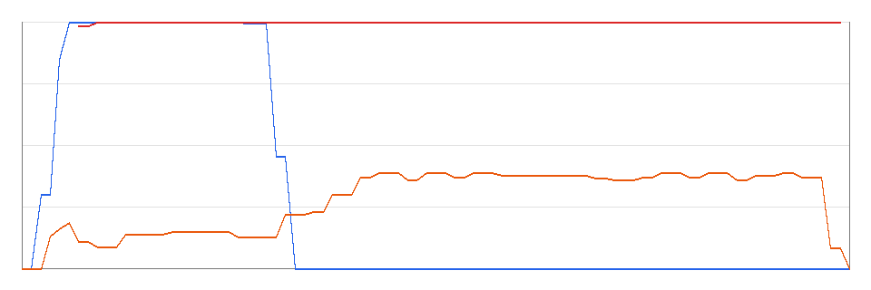
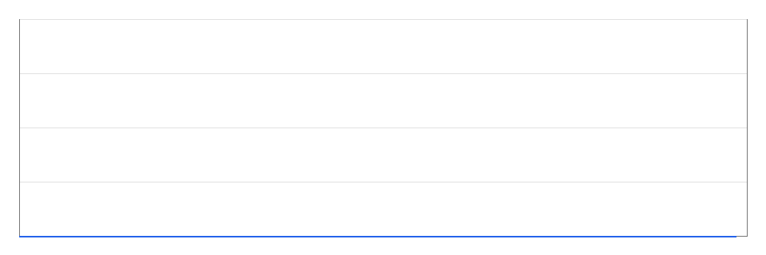
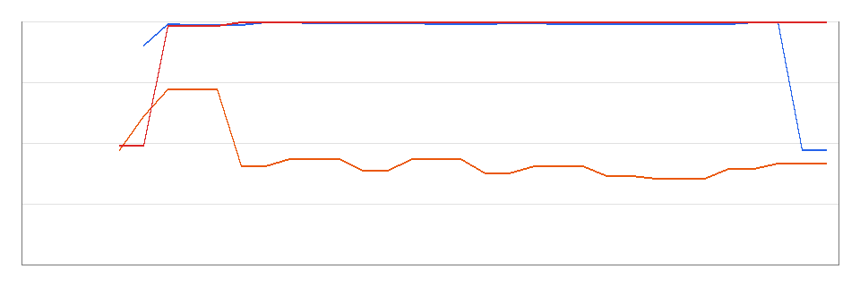

# Load test results (B1-17)

Measured, not estimated: numbers come from Prometheus (`ingest_messages_total`,
`worker_events_total`, `pipeline_latency_ms`, `stream_group_lag`) over each run's window, HTTP
numbers from k6. Generated by `loadtest/report.ts`; reproduce with `bash loadtest/run.sh`
(see [README](README.md)).

Event mix: 70% duplicates (50 hot trade ids), 25% unique events matching the Rates rule, 5% unknown
shapes. Target from the plan: ≥ 10 000 msg/s into ingest, p99 ingest → alert < 500 ms.

| When (UTC) | Run | Workers | Ingest msg/s (avg) | Ingest msg/s (peak) | Worker events/s | ingest→worker p50 / p99 ms | ingest→alert p50 / p99 ms | HTTP p99 ms | HTTP failed | Max lag |
|---|---|---|---|---|---|---|---|---|---|---|
| 2026-11-21 04:04 | http 1000 req/s × 10 (constant) | 1 | 8594 | 10008 | 1523 | 10000.0 / 10000.0 | 10000.0 / 10000.0 | 27.7 | 18.71% | 418249 |
| 2026-11-21 04:09 | http 1000 req/s × 10 (constant) | 1 | 0 | 0 | – | – / – | – / – | 2.2 | 100.00% | – |
| 2026-11-21 04:13 | http 1000 req/s × 10 (constant) | 1 | 9851 | 10054 | 4486 | – / – | 5000.0 / 5000.0 | 37.1 | 0.00% | – |

Machine of the last run: 8 CPU (Apple M2), 8 GB.

## Charts

Blue: ingest msg/s, orange: events processed by the workers per second (left axis, shared);
red: p99 ingest → alert (right axis).

**http 1000 req/s × 10 (constant), 1 worker(s)** (max 10008 msg/s (left), max p99 10000 ms (right))

**http 1000 req/s × 10 (constant), 1 worker(s)** (max 1 msg/s (left), max p99 1 ms (right))

**http 1000 req/s × 10 (constant), 1 worker(s)** (max 10054 msg/s (left), max p99 5000 ms (right))

